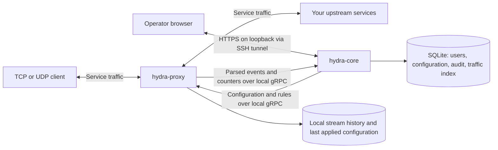

# Hydra

Hydra is a lightweight operations console for authorized Attack/Defense CTF competitions. Use it to put a TCP or UDP proxy in front of your own services, inspect both sides of a conversation, and apply defensive filters without restarting the proxy.

Hydra runs as two native processes on x86_64 Linux. Its design target is **2 vCPU and 2 GiB RAM**. The Vue console is built into the Core binary, and Core uses local SQLite. The VM needs no frontend runtime, external database, or container daemon.

## What you can do

- **Inspect traffic.** Follow live and saved TCP streams and UDP conversations. View decoded fields, HTTP headers, terminal-style text, or captured bytes in hex. Favourite a stream to preserve it through normal rotation.
- **Decode your protocols.** Use the built-in gRPC, HTTP/1.1, UTF-8 and raw profiles or upload a WASM decoder. Ordinary proxying passes unknown protocols through unchanged.
- **Terminate TLS.** Give a TCP service a PEM certificate to inspect HTTPS at the proxy, and optionally speak TLS to the backend. ALPN offers HTTP/1.1 only.
- **Filter traffic.** Add a rule as one regex over the stream with a free-text tag, or as a Python script that returns `False` to block; richer AND/OR conditions stay one click away. Preview against saved traffic or apply rules live. See desired and applied revisions, match counts, and author history.
- **Protect services under load.** Set per-service connection and traffic limits and monitor their effect in the console.
- **Manage the workspace.** Manage users and settings through the console, review audit events, and use the documented HTTPS API.

## Architecture



**Proxy** owns listeners, connection limits, decoding, and rule enforcement. It can continue forwarding with its last applied configuration while Core is unavailable. For ordinary reverse proxying, the upstream sees the proxy's address as the peer address.

**Core** serves the console and API, manages configuration, and indexes telemetry. Core and Proxy communicate over a Unix socket. Normal telemetry sends parsed metadata, not a raw packet feed. Swagger is available at `/docs/` and the OpenAPI contract at `/openapi.yaml`.

## Install and open the console

On an **x86_64 Linux VM running systemd**, download the installer from GitHub:

```bash
wget -O install-hydra.sh https://raw.githubusercontent.com/nrf24l01/ad-hydra/main/scripts/install-hydra.sh
```

Put your verified build archive in the same directory and run the installer as root.

```bash
sudo bash install-hydra.sh --archive ./hydra-linux-x86_64-musl.tar.gz
```

The installer validates the archive before replacing binaries. It installs missing prerequisites on supported apt or dnf systems. See the [installation guide](docs/INSTALL.md) for source options, prerequisites, and recovery details. Hydra expects your upstream services to be running separately.

On first install, read the generated administrator credentials on the VM.

```bash
sudo cat /root/hydra-install-credentials.json
```

From your workstation, open an SSH tunnel. Replace `user@your-vm` with your SSH login.

```bash
ssh -N -L 8080:127.0.0.1:8080 user@your-vm
```

Open **https://localhost:8080** and log in. A fresh install uses a self-signed localhost certificate. Follow the [configuration guide](docs/CONFIGURATION.md) to connect your first service, check captured traffic, and set up filters and retention.

## Maintain an installation

| Installed item | Purpose or location |
| --- | --- |
| `hydra-core.service` | Runs the HTTPS console and API on `127.0.0.1:8080` under the `hydra-core` account. |
| `hydra-proxy.service` | Runs the TCP and UDP listeners under the `hydra-proxy` account. |
| Binaries and unit files | `/usr/local/bin/hydra-{core,proxy}` and `/etc/systemd/system/hydra-{core,proxy}.service`. |
| Core state | SQLite, the signing key, and other private files under `/var/lib/hydra-core/`. |
| Proxy state | Retained traffic and the last applied configuration under `/var/lib/hydra-proxy/`. |
| Configuration | `/etc/hydra/proxy.json`, `/etc/hydra/core-settings/operations.json`, and TLS files under `/etc/hydra/`. |
| Local control socket | `/run/hydra-proxy/proxy.sock`. The installer creates a `hydra-control` group for socket access. |
| Python runtime tooling | The installer reuses an available `uv` or installs its pinned version to `/usr/local/bin/uv` by default. It is not a systemd service. |

Check unit health and follow logs from the VM.

```bash
sudo systemctl status hydra-core hydra-proxy
sudo journalctl -u hydra-core -u hydra-proxy -f
```

Use the console to change service listeners, rules, and traffic retention. Proxy reads `/etc/hydra/proxy.json` at startup. When `flag_pattern` is omitted, the Proxy scanner uses ForcAD's `[A-Z0-9]{31}=` pattern to highlight traffic. Set a custom pattern for a different format or set it to `null` to disable these markers.

For a standard installation, rerun the installer with the new verified archive to upgrade. It preserves existing users, settings, certificates, and systemd units. It backs up the existing database and installation files under `/var/backups/hydra/`, checks both services and the console, and restores the prior installation if the health check fails. For full recovery, also back up the private Core and Proxy state directories and `/etc/hydra/` with ownership and permissions intact. Stop Core before taking file copies of its state, including SQLite sidecar files. Use the deployment procedure for your installation if you customized Core's paths.

## Build from source

Development requires Linux, the pinned Rust and Bun versions, Node 22.18 or later, a native linker, and `protoc`. Build the frontend before Cargo so Core can embed the console.

```bash
(cd frontend && bun install --frozen-lockfile && bun run build)
cargo build --locked --workspace
```

## Further reading

- [Traffic viewer](docs/traffic-view.md) and [service limits and favourites](docs/traffic-protection.md)
- [Python and WASM request checkers](docs/REQUEST_CHECKERS.md)
- [Writing Python exploits for Farm](docs/exploits-python.ru.md) (in Russian)
- [Custom WASM decoders](docs/CUSTOM_DECODERS.md)
- [Installation and recovery](docs/INSTALL.md) and [manual systemd deployment](deploy/README.md)
- [CI builds and release archives](docs/CI_RELEASES.md)
- [Frontend development](docs/vue-frontend.md), [verification](docs/VERIFICATION.md), and [performance measurements](docs/PERFORMANCE.md)
- [Product specification](SPEC.md) and [engineering decisions](DECISIONS.md)
